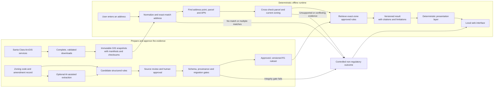

# Santa Clara R1 Zoning Prototype

**Project report — July 18, 2026**

## In brief

This project explores a straightforward question with a surprisingly complicated answer:

> If someone enters a Santa Clara address, can software identify the property and clearly explain a useful set of zoning rules that apply there?

We built a working prototype for properties in Santa Clara's R1-6L and R1-8L single-family residential zones. A user enters an address, and the application finds the corresponding parcel, confirms its zoning, and presents a limited set of residential rules in a clean web interface. The result includes the parcel number, permitted-use information, required approvals, height, stories, structure coverage, setbacks, qualifications, and links back to the supporting sources.

This is intentionally a narrow prototype. It is not a complete answer to everything that could be built on a property, and it is not a legal or planning determination. Its purpose is to prove that the full journey—from public records to an understandable, evidence-backed result—can work reliably.

## The larger goal

The long-term goal is workflow automation for building regulations.

Every local government has its own combination of zoning maps, parcel data, code tables, definitions, exceptions, approval processes, and locally specific rules. Staff and applicants often have to move between several systems and interpret dense material before answering even an apparently simple property question.

The larger product vision is a repeatable workflow that can:

1. gather a jurisdiction's geographic and regulatory sources;
2. turn those sources into structured candidate data;
3. verify and approve consequential rules;
4. connect the rules to the correct properties;
5. produce consistent, source-backed answers; and
6. make uncertainty or required human judgment visible.

Santa Clara's R1 zones gave us a practical place to test that vision without trying to solve every land-use question at once.

## From source material to a user-facing answer

The prototype separates preparation from runtime. Geographic and regulatory sources are collected, checked, and versioned before they can support a property result. At runtime, the application follows a deterministic path and withholds regulatory conclusions whenever the evidence does not support one.

The dashed path shows where AI can assist during preparation without becoming the authority for a live result. The solid runtime path uses only validated local artifacts. Citations, limitations, and version identities remain attached through the final interface.

## Why we started small

Zoning systems become complicated quickly. A city may have dozens of base zones, overlays, specific plans, historic restrictions, special approvals, and state-law interactions. Attempting to automate all of that in the first version would make it difficult to tell whether the basic workflow was sound.

We therefore focused on two closely related residential zones and a short list of useful regulations:

- single-family dwelling use status;
- Zoning Clearance and Architectural Review requirements;
- maximum primary-structure height;
- maximum stories;
- maximum structure coverage; and
- front, rear, interior-side, and street-side setbacks, including supported upper-story differences.

This scope was large enough to exercise the complete system while remaining small enough for careful source review and testing.

## What the prototype does

The user experience begins with one familiar input: a street address.

Behind that simple search, the application performs a series of controlled steps:

1. It standardizes the entered address and finds an exact match in Santa Clara's address data.
2. It locates the parcel containing that address point and returns the Assessor's Parcel Number.
3. It checks the parcel against the current zoning data and requires the two zoning records to agree.
4. If the property is in R1-6L or R1-8L, it retrieves the approved rules for that exact zone.
5. It organizes the result into plain sections for use, approvals, key standards, setbacks, qualifications, limitations, sources, and data versions.

If the address is ambiguous, unmatched, outside the supported R1 data, or associated with conflicting geographic evidence, the application does not guess. It returns a controlled explanation and withholds unsupported regulatory conclusions.

## Building a trustworthy result

The central design choice was to make the authoritative runtime deterministic.

The regulations used by the application are stored in a structured, versioned ruleset. The same address, geographic snapshots, ruleset, and software contracts produce the same result. The application does not ask a language model to invent or reinterpret a numeric zoning standard each time someone searches.

Every consequential rule retains its source and context. The interface keeps those citations unobtrusive during ordinary use while allowing a user to inspect the underlying code sections, source documents, and data versions.

The system also preserves uncertainty rather than smoothing it away. During source review, we found a conflict affecting the R1-8L street-side setback: one table stated 10 feet, while a more specific written provision required at least 15 feet. The prototype uses the documented 15-foot project value under its project-approved resolution policy, but it also preserves both source assertions and clearly states that official clarification is still pending.

That behavior is important for government workflow automation. Real regulations are not always perfectly clean or internally consistent. A trustworthy system must be able to surface a conflict, apply an approved policy when one exists, and request review when it does not.

## Why versioning matters

A zoning answer is never based on one timeless source. Parcel records change, zoning maps are updated, ordinances are amended, structured rules are reviewed, and application behavior evolves. If those changes are not tracked separately, it becomes difficult to reproduce an earlier result or explain why a later answer is different.

The prototype therefore versions each major part of the evidence chain:

| Versioned component | Version used by this prototype | What it identifies |
|---|---|---|
| Address data | Snapshot dated July 16, 2026 | The city address records used to find the property |
| Parcel and zoning data | Snapshot dated July 14, 2026 | The parcel and current-zoning records used for the spatial lookup |
| Regulatory sources | July 2025 code, audited through July 16, 2026 | The code baseline and the later legislation reviewed for relevant changes |
| Approved ruleset | `2026-07-17.2` | The exact structured R1 rules accepted for runtime use |
| Pipeline and presentation contracts | `1.0.0` | The meaning and organization of the result passed through the application and displayed to the user |

These versions appear with the result rather than remaining hidden inside the software. Together with the entered address and approved assumptions, they identify the materials and behavior that produced the answer.

This gives the project a practical reproducibility promise: the same versioned inputs produce the same result. When a city updates its maps or regulations, the workflow can create a new snapshot or ruleset instead of silently overwriting the old one. A changed answer can then be traced to a specific data, legal, or software update. That history will be especially important if the workflow is eventually used to maintain regulatory tools for many jurisdictions.

## Where AI fits

AI can be valuable in building and maintaining a system like this. It can help locate relevant provisions, extract candidate tables, normalize terminology, identify cross-references, and suggest tests. In a broader multi-city workflow, those capabilities could greatly reduce the time required to prepare a new jurisdiction.

But AI-assisted extraction is not automatically authoritative. Candidate rules still need source checks, validation, and approval before the application relies on them. In this prototype, the live property result is assembled from validated geographic snapshots, deterministic lookup logic, and an approved ruleset. No API key or runtime AI service is required.

This separation gives the future workflow the speed benefits of AI without making each user-facing answer depend on an unpredictable interpretation.

## What we accomplished

The prototype now includes:

- a validated citywide snapshot containing 67,243 address points;
- validated R1 parcel and current-zoning snapshots containing 16,193 records each;
- an audited zoning-code baseline and later-amendment record;
- a structured ruleset with ten supported capabilities in each zone, represented by 20 zone-specific rule records;
- deterministic address, parcel, zoning, and regulatory retrieval;
- a responsive local web interface with visible limitations and inspectable sources; and
- a complete acceptance matrix covering successes, unsupported properties, unit addresses, ambiguity, missing addresses, geographic disagreement, and integrity failures.

## How we validated it

Testing was a substantial part of the project because a zoning tool must do more than produce the right-looking answer for one address. It also has to reject incomplete evidence, preserve uncertainty, and behave consistently when its inputs are reordered or damaged.

The test suite grew alongside the prototype. It checks that:

- downloaded GIS records are complete and match their manifests and checksums;
- address normalization, duplicate records, parcel geometry, and zoning agreement behave as intended;
- malformed, incomplete, unapproved, or modified regulatory data is rejected;
- every supported rule retains its required citations, conditions, exceptions, and conflict references;
- unsuccessful address and spatial outcomes never acquire unsupported regulations;
- the presentation does not hard-code zoning values or silently omit an unfamiliar rule;
- the web interface preserves the approved result, source receipts, qualifications, and safe error states; and
- representative R1-6L and R1-8L addresses work through the complete production path.

Some tests deliberately mutate otherwise valid data—for example, changing a regulatory value, removing a required capability, breaking a citation, altering a source checksum, or creating inconsistent zoning evidence. These tests demonstrate that the system fails visibly and safely rather than returning a polished but unsupported answer.

The final validation run passed all 151 automated tests without skips. The application produced identical results across different request orders and independent processes, and it continued to work when outbound network connections were blocked. We also reviewed the interface at desktop, tablet, and mobile widths and checked its primary keyboard, disclosure, source, and error interactions.

Together, this testing confirmed not only that the successful examples work, but also that the prototype respects its boundaries when it cannot safely answer.

## What the prototype does not do

The application retrieves selected base-zone standards. It does not yet calculate a parcel-specific building envelope or decide whether a proposed design complies.

It also does not currently evaluate:

- accessory dwelling units, junior ADUs, or SB 9 projects;
- parking, density bonuses, or other state-law overrides;
- historic, airport, flood, specific-plan, or other overlays;
- setback averaging, encroachments, alleys, or legal nonconformities;
- existing development and remaining structure coverage;
- whether a property is a corner lot; or
- properties outside R1-6L and R1-8L.

These subjects are labeled as not evaluated rather than being treated as prohibited or irrelevant. The interface and results should continue to be described as a technical feasibility prototype, not a complete entitlement analysis or legal opinion.

## What this teaches us about the future product

The project demonstrates that building-regulation automation is not just a document-search problem. A useful answer depends on several disciplines working together: source acquisition, geographic matching, regulatory modeling, validation, conflict handling, software logic, and clear presentation.

It also suggests a scalable product pattern. Common ideas such as height, setbacks, use permissions, and approval requirements can share consistent meanings and software behavior across cities. Local values, terminology, exceptions, conflicts, and unusual provisions should remain owned by each jurisdiction. When a local rule does not fit a shared concept, the system should represent it explicitly rather than forcing it into an inaccurate category.

The next versions can expand one verified capability at a time: more residential rules, proposal inputs, parcel calculations, additional zones, overlays, and state-law interactions. In parallel, the data-preparation work can become a reusable workflow that helps create and update these structured regulatory packages for many local governments.

## Conclusion

The Santa Clara R1 prototype proves a modest but meaningful idea: a user can begin with an ordinary address and receive a consistent, readable, evidence-backed view of selected zoning standards without navigating several disconnected sources.

More importantly, it establishes the foundation for the larger goal. The same overall workflow—gather, structure, verify, connect, evaluate, explain, and cite—can guide the development of broader building-regulation automation while keeping human review and authoritative evidence at the center.

For setup and local operation, see the [README](../README.md). For the detailed validation record, see the [archived R1 prototype progress](progress-archive/2026-07-18-r1-prototype-progress.md). For implementation scope and design decisions, see the [R1 prototype plan](r1-prototype-plan.md).
