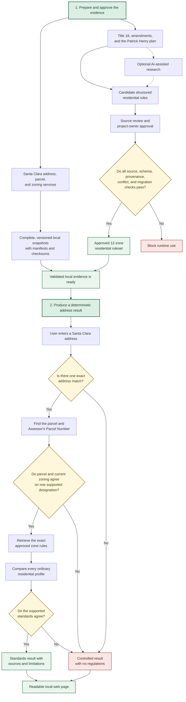

# Santa Clara Zoning Explorer

**Project report — July 19, 2026**

## In brief

This project began with a practical question:

> Can someone enter a Santa Clara address and receive a clear, source-backed explanation of selected zoning standards for that property?

The first release proved that workflow for the City's two R1 zones. The same foundation has now been expanded into **Santa Clara Zoning Explorer**, a broader residential product covering selected citywide R zones and Patrick Henry plan designations.

A user enters an address. The application matches it to local address and parcel records, confirms the exact zoning designation, and presents the residential uses and common base-zone standards supported for that zone. Results include approvals, height, stories, structure coverage, gross residential density, setbacks, qualifications, conflicts, source receipts, and data versions.

The product is intentionally focused. It provides selected residential zoning information, not a complete entitlement analysis, buildability study, or legal or planning determination.

## What someone can do with it

The application turns an ordinary address search into a readable residential zoning summary. For a supported property, it can show:

- the matched address, parcel number, and exact zoning designation;
- how the zoning table treats single-family, two-family, and multifamily dwellings;
- whether Zoning Clearance and Architectural Review apply within the supported scope;
- maximum primary-structure height and stories;
- maximum structure coverage, including source tables that list no maximum;
- the base gross residential density range;
- front, rear, interior-side, and street-side setbacks;
- special conditions, unresolved or project-resolved source conflicts, and topics that are not evaluated; and
- the regulatory sources and versioned data used to produce the result.

The interface presents the common standards immediately. It does not ask the user to choose a building type when the supported standards are identical across the residential types allowed in that zone. The underlying system still keeps single-family, two-family, and multifamily identities separate so a later version can ask for a selection if their standards genuinely diverge.

## Residential scope

The approved regulatory package contains 12 exact zoning designations:

| Zone group | Designations | Residential treatment in this phase |
|---|---|---|
| Low-density R1 | `R1-6L`, `R1-8L` | Ordinary single-family standards, plus a separately disclosed Chapter 18.24 two-home pathway whose dimensional analysis is not yet evaluated |
| Mixed residential | `R2` | Single-family, two-family, and multifamily uses |
| Two-family and multifamily | `R3`, `R4` | Two-family and multifamily uses |
| Higher-density residential | `R5`, `R6` | Multifamily use; approved rules are represented and tested, but the current City GIS snapshot contains no exact live features in either zone |
| Patrick Henry | `PH-R5`, `UV`, `VR`, `UC`, `HDF` | Multifamily use with plan-specific qualifications |

“Not listed” in a controlling zoning table is preserved as exactly that. The product does not automatically turn an unlisted use into a broad statement that the use is prohibited under every possible circumstance.

Two-family development also retains its own meaning. An ordinary two-family structure contains two dwelling units, even though its analysis can reuse the multifamily workflow. The R1 two-home provisions are a different special pathway because they can involve attached or detached homes and depend on proposal facts the current product does not collect.

## Supported standards

The current product concentrates on the main base-zone regulations already established in the original work, with gross residential density added during the expansion:

| Family | What the product reports | Important boundary |
|---|---|---|
| Residential use | Source-table treatment of single-family, two-family, and multifamily dwellings | A use classification does not eliminate separate approval requirements |
| Project approvals | Zoning Clearance and the base Architectural Review requirement | Not every exemption, hearing trigger, and project condition is evaluated |
| Height and stories | Numeric base limits or an explicit FAA-controlled result | The application does not measure a proposed building or classify its stories |
| Structure coverage | A percentage, a lot-size tier, or “no maximum listed” | Existing and remaining coverage are not calculated |
| Gross residential density | A sourced minimum-to-maximum range in dwelling units per acre | The range is not a parcel unit-yield calculation |
| Setbacks | Front, rear, interior-side, and street-side base requirements, including supported story differences | The application does not calculate a parcel-specific building envelope |

This is a meaningful set of common standards, but it is deliberately not every residential regulation in the zoning code.

## From source material to a user-facing answer

The product separates evidence preparation from the live address lookup. Geographic and regulatory sources are collected, checked, versioned, and approved before they can support a result. The running application uses those validated local artifacts and withholds regulations when the evidence does not safely support them.

The two numbered headers separate preparation from runtime without requiring long cross-diagram arrows. Decision diamonds make each fail-closed branch explicit. The dashed path shows where AI may assist with research or candidate extraction; it does not approve rules or generate numeric zoning standards for a live result.

## One project, developed in stages

Although the work had a focused first release and a broader second phase, it forms one continuous workflow.

### 1. Prove the complete path with R1

The project first concentrated on `R1-6L` and `R1-8L`. That narrow scope made it possible to test every major step carefully: downloading public geographic data, matching an address to a parcel, confirming zoning across two layers, translating code provisions into structured rules, preserving citations and conflicts, and displaying an understandable result.

The first release, `v0.1.0-r1-prototype`, established that the complete address-to-standards journey could work offline and deterministically. It also created the regression baseline that the expansion had to preserve.

### 2. Broaden and verify the residential sources

The next phase added the remaining selected citywide R zones and the Patrick Henry residential designations. That required more than copying numbers into a table. The work checked:

- the correct residential use rows for single-family, two-family, and multifamily dwellings;
- the applicable height, story, coverage, density, and setback tables;
- later Title 18 amendments that might affect the July 2025 consolidated code;
- the adopted Patrick Henry plan and the relationship among its source labels and the live `HDF` GIS designation; and
- the current City GIS counts for every exact target designation.

The resulting residential snapshot contains 18,677 parcel features and 18,677 matching current-zoning features. Ten target designations appear in that snapshot. `R5` and `R6` are retained as code-defined and tested rule targets, but no exact live features were observed, so the project does not invent addresses for them.

### 3. Generalize the regulatory model

The original data model assumed one ordinary single-family profile per R1 zone. The expanded model had to represent several residential uses and structures without blurring their legal meaning.

It now keeps separate concepts for legal use, primary-structure type, analysis workflow, ordinary profiles, and special pathways. It also preserves nonnumeric outcomes such as:

- **No maximum listed:** the controlling base table provides no maximum in that cell; this is not a claim that development is unlimited.
- **FAA controlled:** the source assigns control to FAA requirements instead of supplying an ordinary height or story number.
- **Plan dependent:** no universal numeric base value is available without a controlling plan or project record.
- **Not evaluated:** the topic is relevant, but the current product lacks the facts or capability needed to reach a conclusion.
- **Review required:** the approved evidence cannot safely support one deterministic answer.

Each major revision was added as a new versioned artifact. Earlier candidates, schemas, crosswalks, and the released R1 rules remain preserved rather than being silently overwritten.

### 4. Author and approve the expanded rules

The rules were added in reviewable tranches: first the R1 migration, then `R2` through `R6`, then gross residential density, and finally the Patrick Henry designations. The approved residential ruleset contains 196 use- and profile-owned rule records and two special pathways.

Approval was a separate step from authoring. Candidate data could be checked, replayed, and compared with its predecessors, but it could not power the application until every required record and the complete 12-zone package were approved for runtime use.

### 5. Connect the expanded backend and interface

The address lookup was generalized to use the residential GIS snapshot while preserving exact designation matching. The rules loader, standards retrieval, result contract, presentation layer, and default web application were then connected in small acceptance-gated steps.

The interface retained the original product's approachable layout and green visual system while removing active R1-only and prototype language. It now presents residential uses, common standards, density, special pathways, conflicts, limitations, and source receipts for the expanded scope. It is responsive across desktop and mobile layouts and includes the faint decorative `YIMBY` wordmark requested during final visual review.

### 6. Harden the release path

The release audit tested a clean copy of the repository rather than relying on files already present on a developer's machine. That exposed a missing Patrick Henry source document in the first residential runtime package. The application correctly refused to start with incomplete approved evidence.

The packaging problem was fixed with a new, source-complete bundle while preserving the earlier bundles unchanged. A consolidated residential acceptance harness and a read-only GitHub Actions workflow now reproduce the bundles, validate the full regulatory lineage, run the complete test suite, and check repository integrity from a clean checkout.

## How the product earns trust

Several design choices are more important than any individual screen.

### It preserves the evidence

Public GIS downloads, zoning-code material, the Patrick Henry plan, rulesets, and release bundles have explicit versions, manifests, file sizes, and checksums. New source retrievals go into new snapshots instead of replacing old evidence.

### It does not guess

An unmatched or ambiguous address, conflicting geographic evidence, an unsupported exact zone, incomplete source data, a damaged ruleset, or a future difference among structure-specific standards produces a controlled result without regulatory cards. In project shorthand, the application “fails closed”: it prefers no zoning conclusion to a polished but unsupported one.

### It keeps conflicts visible

Real source material is not always internally consistent. The project preserves each conflicting assertion and records any selected project value separately from the source disagreement. Examples include:

- the R1-8L street-side setback, for which the project uses 15 feet while retaining the competing 10-foot assertion;
- the R5 density range, for which the project uses Table 1-1's 51–100 dwelling units per acre;
- the R6 density range, for which the project uses Table 1-1's 60–350 dwelling units per acre; and
- the PH-R5 density range, for which the project uses 51–100 while retaining competing 51–99 assertions.

These are documented project resolutions, not claims that the City has corrected its source documents.

### It keeps sources attached to the answer

Rules retain citations, source versions, conditions, exceptions, conflicts, and approval status. The interface keeps the ordinary result readable while allowing someone to inspect the supporting source receipts and the versions that produced it.

### It is deterministic and local

The application does not need an API key, a live City GIS connection, a database, or an AI service at runtime. The same versioned inputs and software contracts produce the same structured result and rendered page. This makes an answer reproducible and lets tests cover network-independent operation.

## Where AI fits

AI can help researchers locate provisions, extract candidate tables, normalize terminology, identify cross-references, and propose tests. Those uses could make future jurisdiction onboarding and source maintenance substantially faster.

AI output is not treated as regulatory authority. Candidate conclusions must still be checked against authoritative material, represented in a validated contract, and approved before runtime use. The live application retrieves approved data deterministically; it does not ask an AI model to interpret zoning law for each address.

## Validation and release readiness

The current release candidate has been checked at several levels:

- 67,243 citywide address points support local address matching;
- the residential GIS package contains 18,677 validated parcel records and the same number of current-zoning records;
- ten live target designations are exercised through real source-verified address fixtures, while `R5` and `R6` are covered without invented real-world locations;
- the approved ruleset covers all 12 target designations, 196 approved rules, and two special pathways;
- the complete repository suite passes all 354 automated tests with no failures, errors, or skips;
- tests deliberately damage checksums, approvals, migrations, citations, source relationships, zoning evidence, and rule values to confirm that unsafe data is rejected;
- independent processes and different request orders produce identical structured and rendered results;
- the application starts and completes its acceptance cases with outbound network access blocked;
- the source-complete runtime package reproduces byte for byte from committed inputs; and
- the Python 3.9 clean-checkout workflow passed on GitHub, including dependency checks, two bootstrap passes, regulatory validators, result-contract validators, the residential release harness, the complete suite, JavaScript syntax, and whitespace integrity.

Manual review also covered the default interface, source disclosures, controlled failures, and responsive desktop and mobile presentation.

## Important versions

| Component | Current identity | What it identifies |
|---|---|---|
| Released baseline | `v0.1.0-r1-prototype` | The preserved two-zone R1 release merged through PR #1 |
| Current release | `v0.2.0` | The validated residential expansion described by this report |
| Address data | Snapshot dated July 16, 2026 | The citywide address records used for exact matching |
| Residential parcel and zoning data | Snapshot dated July 18, 2026 | The filtered parcel and current-zoning evidence for the 12 exact target designations |
| Regulatory sources | July 2025 Title 18 baseline, audited through July 18, 2026 | The consolidated code and later-legislation review used for the expansion |
| Patrick Henry source | Adopted plan dated March 2022 | The source for the supported Patrick Henry residential designations and qualifications |
| Approved residential ruleset | `2026-07-19.5` under schema `3.2.0` | The exact approved 12-zone regulatory package |
| Residential result contract | `2.1.0` | The versioned address-to-standards result passed through the backend |
| Source-complete residential add-on | `2026-07-19.2` | The reproducible GIS and Patrick Henry source package used with the preserved R1 runtime bundle |

The release title is **Santa Clara Zoning Explorer v0.2.0 — Residential Expansion**. Its tag identifies the validated `main` commit containing the final release record; the preserved `v0.1.0-r1-prototype` tag continues to identify the historical R1 baseline.

## What the product does not determine

The Explorer retrieves selected base-zone standards. It does not decide what can ultimately be approved or built on a property.

It does not currently:

- evaluate a proposed design or calculate a parcel-specific building envelope;
- calculate dwelling-unit yield from density and acreage;
- account for density bonuses, affordability programs, development agreements, or state-law adjustments;
- evaluate ADUs, junior ADUs, SB 9 eligibility, or the dimensional branches of the R1 two-home pathway;
- calculate existing or remaining structure coverage;
- evaluate every setback exception, encroachment, alley credit, official plan line, or legal nonconformity;
- determine all Historic, airport, flood, specific-plan, or other overlay effects;
- evaluate the 32-foot proximity transition, Objective Design Standards, Patrick Henry recreation-space standards, or detailed plan/project conditions;
- analyze commercial development; or
- provide live-address results for `R5` or `R6` while the preserved City snapshot contains no exact features for those designations.

These topics are treated as outside scope or `not evaluated`, not as prohibited or irrelevant. A user should still consult the City and qualified professionals for a property-specific planning or legal determination.

## What the project demonstrates

The first R1 release proved that a careful address-to-zoning vertical slice was possible. The residential expansion shows that the same foundation can grow without abandoning its evidence trail or rewriting history.

The work also demonstrates that zoning automation is not merely a document-search task. A trustworthy result depends on complete geographic data, exact identity matching, regulatory research, structured representation, human approval, conflict handling, deterministic software, testing, and clear communication of limitations.

That pattern is reusable. Common concepts such as height, setbacks, use classifications, approvals, and density can share software behavior, while each jurisdiction keeps ownership of its values, terminology, citations, conditions, conflicts, and unusual rules.

## Sensible next steps

The residential expansion phase is complete. Future work can remain incremental:

- ask for a structure selection only when supported standards materially differ;
- add proposal facts and evaluate one additional regulation family at a time;
- improve public-facing source links and explanations;
- automate detection of code, amendment, and GIS changes while retaining human approval; and
- generalize the evidence-preparation workflow for additional jurisdictions without carrying Santa Clara assumptions into their rules.

## Conclusion

Santa Clara Zoning Explorer now provides a broader, evidence-backed view of selected residential zoning standards by address. It grew from a two-zone proof into a 12-designation residential product while preserving the original release, adding two-family and multifamily support, incorporating Patrick Henry, and strengthening the system's source, conflict, testing, and clean-checkout guarantees.

Its most important promise remains modest and useful: when the approved evidence supports an answer, present it clearly and cite it; when the evidence does not support an answer, say so rather than guess.

For setup and local operation, see the [README](../README.md). For current implementation and validation status, see the [progress ledger](progress.md). The [original R1 prototype report](prototype-report.md) remains preserved as the historical account of the first release.
